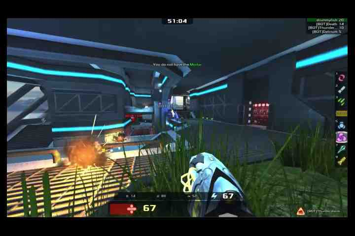
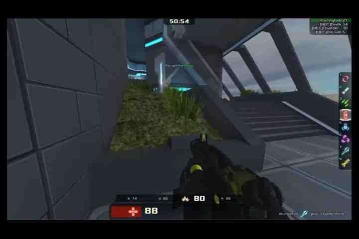

# V37 epoch 1: trigger packets and final-15-second host content

Analysis of the saved 2026-11-06 run, IDs **3,006,000–3,006,749**. No further transmission, capture session or hardware operation was started.

[Exact JSON records](v37-epoch1-trigger-and-host-content-20261106.json) · [Complete matched rejected-ID list](v37-epoch1-matched-rejected-ids-20261106.txt)

## Outcomes, pacing and coverage

Host: 750 encoded = **737 complete sends + 13 replacements**; zero partials/skipped slots. Feedback: **405 accepted / 327 rejected / 5 sends without matching ACKs**.

The five unmatched IDs are **3,006,286; 3,006,287; 3,006,366; 3,006,384; 3,006,489**. The linked plain-text file lists all **327 unique matched rejected-ACK IDs**, one per line. JSON also includes inclusive ranges. These are not a fabricated per-ID account of all 332 receiver-counted drops.

Actual video sender lifetime including feedback drain: **30.3394892 seconds**. Requested mode **hybrid**; actual backend **`windows-high-resolution`**, requested/effective tail **600 µs**, zero fallback/runtime/close failures. MSV1 application wire rate **4.011786460795128 Mbps**; actual host send rate **24.291773508 fps**. Wire rate excludes UDP/IP/Wi-Fi and AV traffic.

Npcap on Wi-Fi captured/received **20,006 packets**, with **zero reported capture drops**. Both logger drop counts were zero. The saved full-run reconstruction validates all **737 complete JPEG frames** from **14,652 outbound datagrams** in increasing within-frame chunk order. The current extraction rechecked all 737 full-frame CRCs against the preserved export and its unchanged pcap hash.

STOP is verified at pcap frame **19,536**, Unix `1793990268.949905000`. AV/media ended `2026-11-06T18:37:48.950600Z`; capture finalized naturally at `18:39:49.754587Z` with no forced stop. Capture covered the video and exact STOP; this observation point is the Windows interface, not RF.

Full-to-full packet intervals below use adjacent 1024-byte payload chunks within one frame; boundaries and short tails are excluded. Percentiles use nearest rank. Each clock is evaluated separately.

| Observation | Samples | Median ms | p95 ms | p99 ms | Maximum ms |
| --- | ---: | ---: | ---: | ---: | ---: |
| Host post-send API | 13,179 | 1.5590 | 2.1167 | 3.2874 | 4.7241 |
| Npcap interface | 13,179 | 1.5590 | 2.0820 | 3.3100 | 4.6940 |

## First retained trigger: frame 3,006,027

Header **`capture_us=1793990239651336`**. JPEG length **21,252 bytes**, MSV1 datagram bytes **22,092**, **21 chunks**. Whole-JPEG CRC declared in MSV1 headers **`db52ded8`**, independently recomputed from captured payloads **`db52ded8`**: match. This is compressed-JPEG integrity, not a decoded-pixel or radio-receipt check.

Source **192.168.0.47:52181 → 192.168.0.157:5533**. Each requested record below carries 1,024 JPEG bytes plus the 40-byte MSV1 header (1,064 UDP payload bytes). Host times are monotonic seconds sampled after send API return; Npcap times are Unix seconds.

| Offset | Payload bytes | Host API seconds | Npcap Unix seconds | Pcap frame |
| ---: | ---: | ---: | ---: | ---: |
| 0 | 1,024 | 1485322.0139547 | 1793990239.671471000 | 593 |
| 9,216 | 1,024 | 1485322.0289994 | 1793990239.686552000 | 603 |
| 10,240 | 1,024 | 1485322.0304987 | 1793990239.688039000 | 604 |
| 11,264 | 1,024 | 1485322.0322895 | 1793990239.689807000 | 605 |
| 12,288 | 1,024 | 1485322.0338285 | 1793990239.691356000 | 606 |
| 16,384 | 1,024 | 1485322.0400860 | 1793990239.697621000 | 612 |
| 17,408 | 1,024 | 1485322.0420231 | 1793990239.699551000 | 613 |

Receiver-reported incoming **and active IDs are 3,006,027** at expected **10,240**, observed **12,288**. The observed packet's local socket-to-consumer delay was **49.848 ms**, as supplied by the receiver agent; no host/receiver clock subtraction produced that value. Both implicated intervening chunks, 10,240 and 11,264, are present in the PC capture. Their later fate remains unknown.

Receiver final **2053/2053/2053/558** matches increases **405/405/405/332**. Queue drops **5,468 total / +3,401**, peak **32/32**. Core faults/overflows/underruns zero; STOP restored power saving to 1. These are operator-provided records, not a fresh read of the remote USB export by this PC. Runtime trace losses are explicit, and the initiating overflow predates the retained ring. That lost receiver history is not reconstructed or reassigned to this first retained trigger.

## Did the outgoing clip keep changing in the final 15 seconds?

**Yes, at the host.** Nominal slots +15.00 through +29.96 seconds contain **375 distinct source timestamps** (no loop) and **375 captured outbound frames**. All **375 decoded content crops** and **375 central playfield crops** have distinct RGB hashes. None of the 374 consecutive comparisons was identical, including the central crop that excludes the outer HUD/borders.

Pillow decoded the saved outbound JPEG payloads for this analysis. Content crop is `(14,37)-(705,442)`; central crop is `(200,130)-(520,330)`, half-open. Central-crop mean absolute RGB difference between consecutive sent images was minimum **1.7835**, median **18.8909**, maximum **82.7202** on the 0–255 channel scale. These are software image-change measurements, not FPGA/display timing or an optical motion classifier.

The unchanged extracted samples below also visibly differ in viewpoint, weapon and HUD content. Their header capture timestamps, source PTS, SHA256 and matched-ACK status are preserved in JSON. Samples at +15 and +29.96 had no matched accepted ACK; +20 and +25 had matched accepted ACKs. An ingress ACK is not optical display proof.

| Nominal source slot | Frame | Source PTS µs | Extracted outbound JPEG |
| ---: | ---: | ---: | --- |
| +15.00 s | 3,006,375 | 15007000 | [Unchanged JPEG](v37-epoch1-outbound-samples-20261106/frame3006375.jpg) |
| +20.00 s | 3,006,500 | 20007000 | [Unchanged JPEG](v37-epoch1-outbound-samples-20261106/frame3006500.jpg) |
| +25.00 s | 3,006,625 | 25007000 | [Unchanged JPEG](v37-epoch1-outbound-samples-20261106/frame3006625.jpg) |
| +29.96 s | 3,006,749 | 29940000 | [Unchanged JPEG](v37-epoch1-outbound-samples-20261106/frame3006749.jpg) |

### Outbound image at +15 seconds

### Outbound image at +25 seconds

A held host clip does not explain the similar camera samples. This does **not** establish a handheld freeze, continuous physical motion, or that every accepted image became visible. Camera sampling offsets and the source-slot offsets have not been aligned across devices. Physical progress requires receiver/optical evidence; no cross-clock subtraction was used.

Pcap SHA256: `bf744e70399dd073ff0976c9d7a1cb887414009fd4e68de8d61d74d1b1258bd5`. Raw evidence and the per-frame content-change audit remain in `artifacts/hardware-25fps-6mbps-hybrid600-v37-epoch1-20261106-3006000/`. All extracted JPEG samples retain their original captured bytes. The sender remains stopped.
