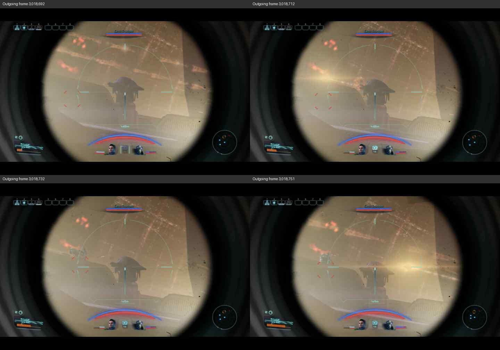

# V38 epoch 3: first Sequence and low-change content audit

Read-only analysis of saved evidence. No further transmission or live capture started. [Exact packet and per-frame comparison records](v38-epoch3-mass-effect-trigger-and-content-20261106.json), [all 21 unmatched IDs](v38-epoch3-mass-effect-unmatched-ids-20261106.txt), [all 122 rejected IDs](v38-epoch3-mass-effect-matched-rejected-ids-20261106.txt), [full run summary](v38-epoch3-mass-effect-2min-20fps-q35-3018000-20261106.json).

## Final accounting, source and capture

IDs 3,018,000-3,020,399: 2,400 target slots, 2,395 complete, zero replacements/partials, five skipped. Matched ACKs 2,252 accepted/122 rejected/21 unmatched. Operator final received/decoded/presented **8,947 each**, dropped 383; deltas **2,252/2,252/2,252/140**. Thus **2,395 complete sends minus 2,252 received minus 140 dropped leaves three unaccounted aggregate outcomes**. All 21 unmatched identities remain individually unresolved; aggregate arithmetic does not assign their outcomes.

Queue drops **0**, cumulative peak **21/32**, rejected_tails **+532**; core faults/overflows/underruns **0**, STOP restored **PS1**. Receiver epoch3 frozen/exported. Margin13/porches unchanged; placement stable in sampled camera views, with glare limiting lower-right detail.

Actual sender duration **120.3313490 seconds**. MSV1 application wire rate **2.934990980613040 Mbps**, excludes UDP/IP/Wi-Fi/AV. Actual pacing backend **windows-high-resolution**, requested/effective hybrid tail 600 us, no fallback/runtime failures. No achieved playback rate is inferred from host target fps.

Source path: `C:\Users\lavat\Downloads\YTDown.com_YouTube_Media__luGrl_3Ajc_Mass-Effect-Legendary-Edition-Combat_004_720p.mp4`

SHA-256 **`fb01977e41e649bfb9fd53d1ee0e6db436127fb86e4b3b7ec303158e0568aff5`**. Source file was used as-is: 1280x720 square pixels, 60 fps, H.264/AAC, 55,394,529 bytes; video duration 132.25 seconds (container 132.307302 seconds). **No preparatory conversion/crop/stretch; source audio ignored. Offset 0, no loop**, confirmed first selected PTS 0, last 119,950,000 us, max_loop 0, no repeated source timestamps. Real-time legacy selection at 20 fps and bilinear scaling to 720x405 in 720x480 JPEG canvas at **(0,37)**, **no side padding, 37 top/38 bottom**, Q35, 5 Mbps cap. This is a new content baseline, not an isolated firmware comparison.

Wi-Fi Npcap interface 4, source 192.168.0.47:61402 to 192.168.0.157:5533; input-only AV source port 61401. **52,880 packets captured/received, 0 reported drops**; pcap/dumpcap/flushed/ps_ifdrop all 0. Exact STOP verified: frame 52,414, Unix 1793995275.960311000. Media ended `2026-11-06T20:01:15.960879+00:00`, capture finalized `2026-11-06T20:03:19.326496+00:00` naturally. Original pcap SHA and fresh export rechecked, all **2,395 complete JPEG CRCs** revalidated with contiguous increasing offsets. Outbound interface capture is not RF or receiver receipt evidence.

## First Sequence: frame 3,018,002

Header **capture_us=1793995155700204**; JPEG **19,908 bytes**, **20 chunks**. Declared and independently recomputed compressed-JPEG CRC32 both **`3e72b3ed`**. Requested packets all appear in outbound capture. Each contains 1,024 JPEG bytes plus 40 MSV1 header bytes (1,064 UDP payload bytes).

| Offset | JPEG bytes | Host post-send monotonic seconds | Npcap Unix seconds | Pcap frame |
| ---: | ---: | ---: | ---: | ---: |
| 0 | 1,024 | 1490238.0857615 | 1793995155.743300000 | 82 |
| 1,024 | 1,024 | 1490238.087853 | 1793995155.745380000 | 83 |
| 2,048 | 1,024 | 1490238.0898749 | 1793995155.747291000 | 85 |
| 3,072 | 1,024 | 1490238.0922006 | 1793995155.749714000 | 86 |
| 4,096 | 1,024 | 1490238.0942162 | 1793995155.751711000 | 87 |

## AV-active +35-38 seconds content comparison

Alignment uses the Windows host AV `active` event at monotonic_ns **1490237494110700**. Frame selection uses first successful post-send monotonic timestamp minus this event, entirely within the Windows monotonic clock. Captured AV START for separate camera alignment: **pcap frame 3, Unix `1793995155.134919000`**. Do not subtract these Unix timestamps from monotonic or ESP clocks. The camera's definition of AV-start and alignment offset are not independently known here.

Strict host interval+35-38 seconds contains **60 outgoing frames**, IDs **3,018,692-3,018,751**, source PTS **34.600-37.550 seconds**. An expanded 34.8-38.2 second interval contains 68 frames. For **every one of those 68 frames**, the original hash-verified source was decoded at its logged PTS, scaled with the sender's canvas method and encoded Q35: the resulting JPEG matched the captured outgoing JPEG **byte-for-byte**.

Within the strict interval: **60 unique source RGB images, 60 unique scaled images, 60 unique outgoing JPEGs; zero identical decoded-content transitions**. Content-region (720x405, excluding black borders) adjacent-frame mean absolute RGB change on 0-255 scale: minimum **0.041158**, median **0.779501**, maximum **11.651973**. Per-frame changes and the fraction of pixels changing by more than 8 levels are in JSON. Nonidentical hashes alone should not be called large scene motion.

Four sampled outgoing frames show a largely steady scoped target with small aim/HUD/lighting/weapon-flash changes. This supports **low-change imagery in the source/outgoing stream**, not a host encoder repeating an identical frozen image over the audited interval. It does **not** rule out an independent receiver hold/stutter, establish continuous receiver presentation, or precisely align the camera's 35-38 second interval. No receiver-freeze attribution is made.

Sender remains stopped. Camera finalized by receiver team.
